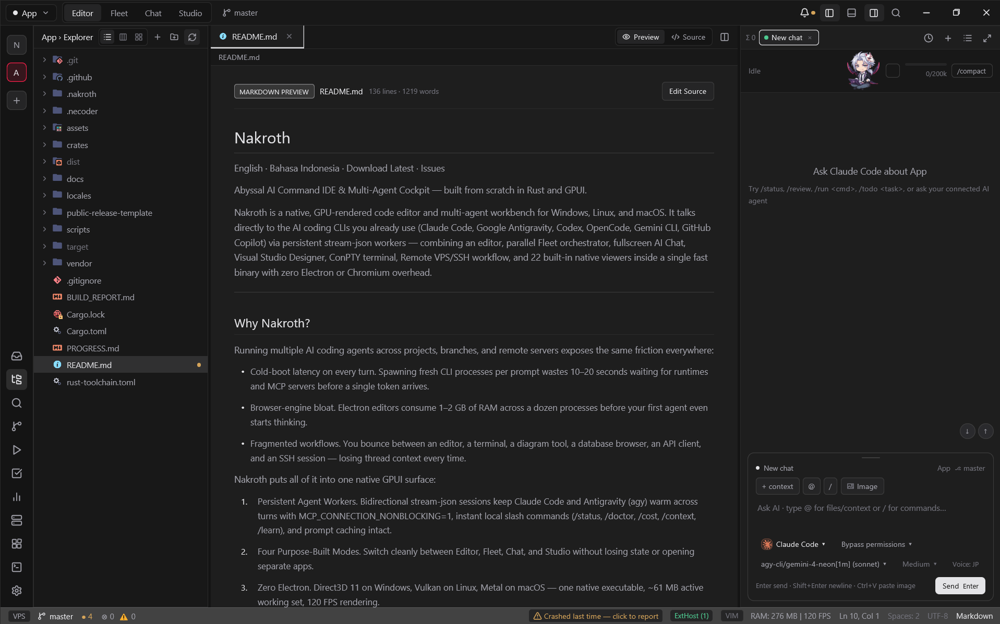
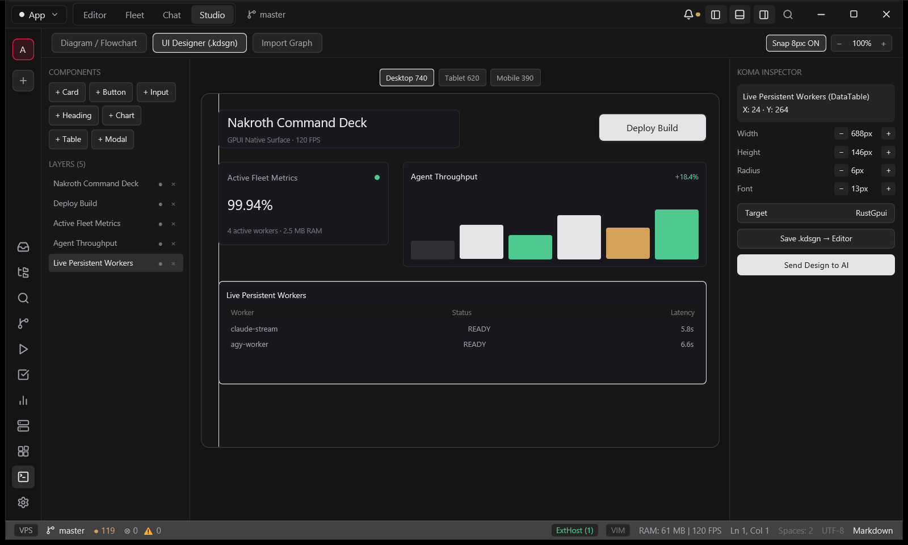
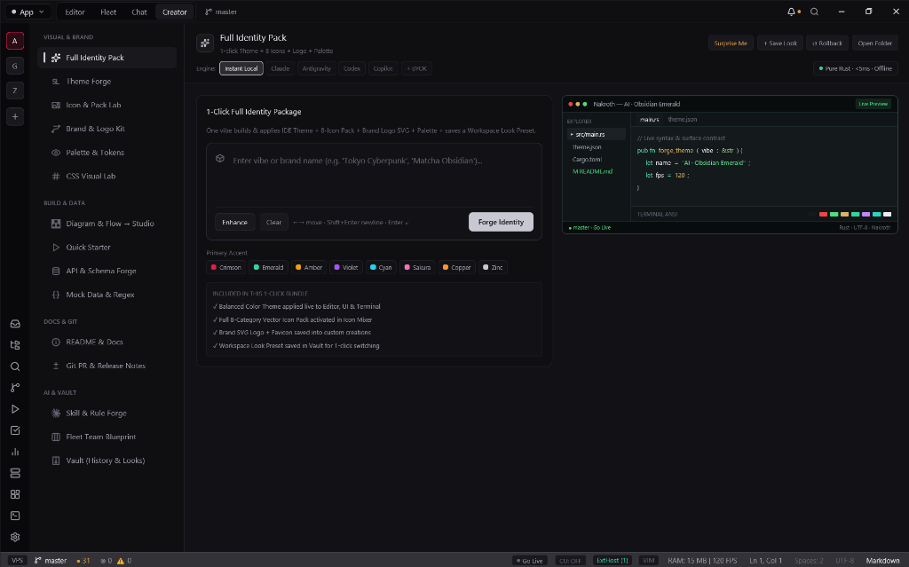

# Nakroth

**English** · [Bahasa Indonesia](#bahasa-indonesia) · [中文 (Mandarin)](#中文-mandarin) · [Download Latest (`v1.1.5`)](https://github.com/ShinRyu04/Nakroth/releases/latest) · [Issues](https://github.com/ShinRyu04/Nakroth/issues)

**Abyssal AI Command IDE & Multi-Agent Cockpit — built 100% from scratch in Pure Rust and GPUI.**

[](https://github.com/ShinRyu04/Nakroth/releases/latest)

-991B1B)

[](LICENSE)

Nakroth is a native, GPU-rendered code editor, multi-agent orchestrator, visual design studio, and AI creator workbench for Windows, Linux, and macOS. It connects natively to every AI coding CLI you already use (**Claude Code**, **Google Antigravity (`agy`)**, **Oh My Pi (`omp`)**, **OpenCode**, **Codex CLI**, **Gemini CLI**, **Pi**, **GitHub Copilot**, and **BYOK API / Ollama**) via persistent bidirectional workers — inside a single fast native binary with **zero Electron or Chromium overhead**.

---

## What's New in `v1.1.5`

- **6-Language Localization (`EN` / `ID` / `中文` / `Tiếng Việt` / `ไทย` / `日本語`)**: Instant full-IDE language switching via a clean Language Dropdown in `Settings › General` and quick switcher in the sidebar.
- **Native OS AI Completion Notifications + Full 21/27 Embedded Voice Pack**: Automatic Windows Action Center Toast / macOS / Linux OS notifications when AI finishes, errors, or awaits approval while unfocused, paired with embedded `RustEmbed` full-length **21 AoV Executioner** & **27 Yuki Kaji Dimension Breaker** voice lines & live voice preview (works out-of-the-box on installer and portable builds).
- **Creator Mode Permanent Versioning, Inline Diff & 1-Click Rollback**: Every workspace file, skill, rule, Theme Forge look, and Icon Pack edit in Creator Mode is versioned (`v1`, `v2`, …) in `.nakroth/creator-versions.json` with inline Diff preview and instant `↺ Rollback` in Vault.
- **Pro VT100 ConPTY Terminal Overhaul**: Win32 `EnumFontFamiliesExW` exact monospace font resolution, single-`StyledText` GPU rendering, seamless full-bleed sidebar shading for TUI apps (`opencode`, `omp`, PowerShell 7), SGR 1006 mouse wheel scrolling, and true `CSI 3 J` scrollback clear.
- **Universal `~/.agents/skills` & Isolated Extension Host**: Automatic discovery of universal agent skills alongside per-provider skill folders, plus crash-isolated Node Extension Host monitoring with automatic recovery.
- **Flush-Left GitHub Markdown Preview & Native Windows 11 Dragging**: Full-width cached Markdown preview with native GitHub HTML `<table>` 2-column card grids, nested inline bold+code rendering, native Windows 11 Aero Snap / multi-monitor titlebar dragging, global sticky-drag protection, and a decluttered Computer Use control panel.

---

## Five Workspaces, One Binary

Code, orchestrate parallel agents, think in fullscreen chat, design UI/diagrams, or forge themes, icons, schemas, and docs — switch seamlessly (`Ctrl+1` .. `Ctrl+5`) without losing state.

<table>
<tr>
<td width="50%" valign="top">
<h3>1. Editor Mode (<code>Ctrl+1</code>)</h3>
<p>120 FPS Tree-sitter editor (24+ languages), GPU minimap, LSP &amp; DAP stdio clients, inline Git hunk review, Pro VT100 ConPTY terminal, Remote VPS/SSH auto-upload, and docked AI cockpit.</p>
<a href="docs/screenshots/editor.png"></a>
</td>
<td width="50%" valign="top">
<h3>2. Fleet Mode &amp; Multi-Agent Lanes (<code>Ctrl+2</code>)</h3>
<p>Fleet Classic Captain/Lead orchestration plus isolated Multi-Agent Session Lanes across Git worktrees, live File-Collision Radar, and 1-click Context Hand-off.</p>
<a href="docs/screenshots/fleet.png"></a>
</td>
</tr>
<tr>
<td width="50%" valign="top">
<h3>3. Chat Mode (<code>Ctrl+3</code>)</h3>
<p>Distraction-free fullscreen AI workspace with synced past CLI sessions, live streaming transcripts, SQLite cross-session Memory Bank, and floating workspace document cards.</p>
<a href="docs/screenshots/chat.png"></a>
</td>
<td width="50%" valign="top">
<h3>4. Studio Mode (<code>Ctrl+4</code>)</h3>
<p>Theme-adaptive UI Designer (<code>.kdsgn</code>) with deterministic Rust GPUI / React Tailwind / Vue / HTML codegen, two-way Mermaid Flowchart, and Tarjan Import Graph.</p>
<a href="docs/screenshots/studio.png"></a>
</td>
</tr>
<tr>
<td colspan="2" valign="top">
<h3>5. Creator Mode (<code>Ctrl+5</code>)</h3>
<p>16 pure-Rust &amp; AI creative labs (Full Identity Pack, Theme Forge, Icon &amp; Pack Lab, Brand &amp; Logo Kit, Palette &amp; Tokens, CSS Visual Lab, API &amp; Schema Forge, Mock Data &amp; Regex, README &amp; Docs, Git PR, Skill &amp; Rule Forge, Fleet Blueprint, and Vault) with permanent versioning, inline Diff preview, and 1-click Rollback.</p>
<a href="docs/screenshots/creator.png"></a>
</td>
</tr>
</table>

---

## Supported AI Agents & Providers

Bring your existing CLI subscriptions, local models, or custom BYOK endpoints — every active agent is automatically connected to Nakroth's MCP broker, universal `~/.agents/skills`, and Computer Use bridge.

| Agent / Provider | Transport | Highlights |
| --- | --- | --- |
| **Claude Code** (`claude`) | Persistent bidirectional `stream-json` | 0ms follow-up cold boot, `MCP_CONNECTION_NONBLOCKING=1`, thinking deltas, tool cards, token meter |
| **Google Antigravity** (`agy`) | Persistent ACP JSON-RPC 2.0 + `stream-json` | Warm prompt cache, live `session/set_model`, `Login via agy` terminal auth |
| **Oh My Pi (`omp`) & Pi (`pi`)** | Persistent `--mode rpc` | Live model switching, 1-click Windows NTFS junction repair, synced past sessions |
| **OpenCode** (`opencode`) | Persistent ACP + Structured JSON stream | Isolated OpenCode model matrix + optional per-agent API connection binding |
| **Codex CLI** (`codex`) | Structured `--json` stream | Reasoning steps, shell execution cards, session resume |
| **Gemini CLI · Copilot · Hermes · Qwen · Kimi · Grok · Goose · Aider · Cursor** | Auto-discovered CLI connectors | Canonical `PATH` detection, 1-click terminal login, isolated per-agent model lists |
| **BYOK Direct API & Ollama** | Native HTTP / SSE + Tool Calling | OpenAI, Anthropic, Gemini, DeepSeek, Z.ai, OpenRouter, Ollama, and custom endpoints (strictly separated from OpenCode) |

---

## Measured Footprint & Responsiveness

Measured on Windows 11 x64 (`v1.1.5` release build):

| Metric | Nakroth (`v1.1.5`) |
| --- | --- |
| **Baseline smoke RAM** (`--smoke-boot`) | `2.6 MB` |
| **Active IDE RAM** (Editor + Explorer + Terminal + AI Panel) | `~15–61 MB` |
| **Frame pacing target** | `120 FPS` native GPU (Direct3D 11 / Vulkan / Metal) |
| **Windows installer size** (`Nakroth-Setup-1.1.5-x64.exe`) | `31.74 MB` (includes CLI & remote server) |
| **Local slash commands** (`/status`, `/doctor`, `/cost`, `/context`, `/learn`) | `< 10 ms` (0 tokens spent) |
| **Windows Explorer Shell Registration** | `< 2 ms` native Win32 Registry FFI (0 UAC prompts) |
| **Persistent follow-up latency** (Claude / Antigravity `agy` Turn 2) | `~5.8 s` / `~6.6 s` first token (skips ~20s cold boot) |

---

## Built-in Native Viewers, Mobile Cockpit & Power Studios

Everything runs lazily on demand (0 MB until opened) inside native GPUI tabs:

- **Mobile Companion PWA**: 10-screen OLED mobile cockpit paired via ISO QR code + Custom VPS Relay (SSH `-R` / HTTPS reverse proxy) — zero API keys on phone.
- **Data & Binary**: SQLite Studio (read/write SQL bar), CSV/Parquet Grid, Hex/PE/ELF/WASM Inspector, ZIP Archive preview, GitHub-flavored Markdown/FluxDoc, Jupyter `.ipynb`.
- **DevOps & API**: REST/GraphQL/cURL Studio (`.http`), OpenAPI Explorer + mock server, Docker Cockpit, Remote VPS/SSH Explorer with `Ctrl+S` auto-upload, Port/Tunnel Manager, `.env` Vault & secret-leak guard.
- **Security & Quality**: SAST Auditor + CVSS triage, Dependency/License Auditor, CyberChef/JWT/Regex Lab, Local SQLite FTS5 Hybrid RAG, Git Commit Graph & Shadow Checkpoints with 1-click Rewind.
- **Extensions & Personalization**: Native VS Code `.vsix` Marketplace + crash-isolated Node Extension Host + Edge WebView2 bridge, custom background & acrylic glass, Icon Pack Mixer, Discord Rich Presence, 15-frame companion mascot + embedded 21/27 voice packs + OS Toast notifications, full **EN / ID / 中文 / VI / TH / JA** localization, and Vim modal editing.

---

## Download & Install (`v1.1.5`)

### One-Line Quick Install
- **Windows (PowerShell)**:
  ```powershell
  irm https://github.com/ShinRyu04/Nakroth/releases/latest/download/install.ps1 | iex
  ```
- **Linux / macOS (Shell)**:
  ```sh
  curl -fsSL https://github.com/ShinRyu04/Nakroth/releases/latest/download/install.sh | sh
  ```

### Direct Packages ([Releases](https://github.com/ShinRyu04/Nakroth/releases/latest))

| Platform | Package | Install / Run |
| --- | --- | --- |
| **Windows 10/11 (x64)** | `Nakroth-Setup-1.1.5-x64.exe` | Double-click installer (adds `nakroth` / `nk` CLI, Explorer menu & optional code file associations) |
| **Windows Portable (x64)** | `Nakroth-Windows-x64-Portable.zip` | Extract anywhere and run `nakroth.exe` |
| **Linux — Ubuntu / Debian** | `nakroth_1.1.5_amd64.deb` | `sudo apt install ./nakroth_1.1.5_amd64.deb` |
| **Linux — Fedora / openSUSE / RHEL** | `nakroth-1.1.5-1.x86_64.rpm` | `sudo dnf install ./nakroth-1.1.5-1.x86_64.rpm` |
| **Linux — Universal** | `Nakroth-1.1.5-x86_64.AppImage` | `chmod +x Nakroth-1.1.5-x86_64.AppImage && ./Nakroth-1.1.5-x86_64.AppImage` |
| **macOS (Apple Silicon M1–M4)** | `Nakroth-1.1.5-arm64.dmg` / `.pkg` | Drag to Applications (or run `.pkg`); unsigned first launch: `xattr -cr /Applications/Nakroth.app` |

Verify integrity using `SHA256SUMS.txt` and `latest.json` attached to every release.

---

## Bahasa Indonesia

**Nakroth `v1.1.5`** adalah IDE AI-first dan kokpit multi-agen yang dibangun 100% murni dengan **Rust + GPUI** (tanpa Electron/Chromium) untuk Windows, Linux, dan macOS.

- **5 Mode Terpadu (`Ctrl+1`–`Ctrl+5`)**: **Editor**, **Fleet** (Fleet Classic + Multi-Agent Session Lanes lintas git worktree), **Chat** (ruang AI fullscreen + Memory Bank SQLite), **Studio** (UI Designer adaptif tema + codegen Rust GPUI/React/Vue/HTML + Mermaid Flowchart + Import Graph), dan **Creator Mode** (16 lab kreatif dengan versioning permanen, inline Diff preview & 1-klik Rollback di Vault).
- **Notifikasi OS Toast AI + Full 21/27 Suara Maskot Embedded**: Notifikasi desktop Windows Action Center / macOS / Linux otomatis saat AI selesai, error, atau butuh approval, lengkap dengan 21 voice line Executioner & 27 voice line Dimension Breaker Yuki Kaji tertanam langsung di binary.
- **Terminal ConPTY Pro & Universal `~/.agents/skills`**: Render font monospace native Win32, kompatibel mulus dengan TUI modern (`opencode`, `omp`, PowerShell 7), SGR 1006 mouse scroll, `CSI 3 J`, plus deteksi skill global otomatis.
- **6 Bahasa Penuh (`EN / ID / 中文 / VI / TH / JA`)** dengan dropdown bersih, Markdown Preview rata kiri + grid kartu HTML GitHub, drag window native Windows 11, dan integrasi Windows Explorer (`<2ms` tanpa UAC).
- **Unduh**: Ambil installer terbaru di [Releases](https://github.com/ShinRyu04/Nakroth/releases/latest).

---

## 中文 (Mandarin)

**Nakroth `v1.1.5`** 是一款使用 **纯 Rust + GPUI** 从零构建的原生 AI 指挥中心 IDE 与多智能体工作台（零 Electron / Chromium 占用），全面支持 Windows、Linux 和 macOS。

- **五大工作区模式 (`Ctrl+1`–`Ctrl+5`)**：**编辑器**、**舰队**（经典编队 + 独立多智能体工作树通道）、**对话**、**工作室**（自适应主题 UI 设计器 + 代码生成 + Mermaid 流程图 + 依赖图）与 **创作中心**（16 个交互式创作工坊，支持永久版本记录、内联 Diff 预览与一键回滚）。
- **原生系统 AI 完成通知与内置完整语音包**：AI 完成任务、报错或等待审批时自动推送系统通知，并内置 21 条 Executioner 与 27 条 Dimension Breaker 完整语音包（安装版与便携版开箱即用）。
- **专业 VT100 ConPTY 终端与通用 `~/.agents/skills`**：原生等宽字体解析、完美适配 `opencode` / `omp` / PowerShell 7、支持 SGR 1006 滚轮与 `CSI 3 J` 清屏。
- **完整六语界面（英语 / 印尼语 / 简体中文 / 越南语 / 泰语 / 日语）**、GitHub 卡片式 Markdown 预览与原生 Windows 资源管理器集成。
- **立即下载**：前往 [Releases](https://github.com/ShinRyu04/Nakroth/releases/latest) 获取最新版安装包。

---

## License

Copyright © 2026 [ShinRyu04](https://github.com/ShinRyu04). **All Rights Reserved.**  
Official prebuilt binaries are provided for personal and evaluation use. See [LICENSE](LICENSE) for details.
