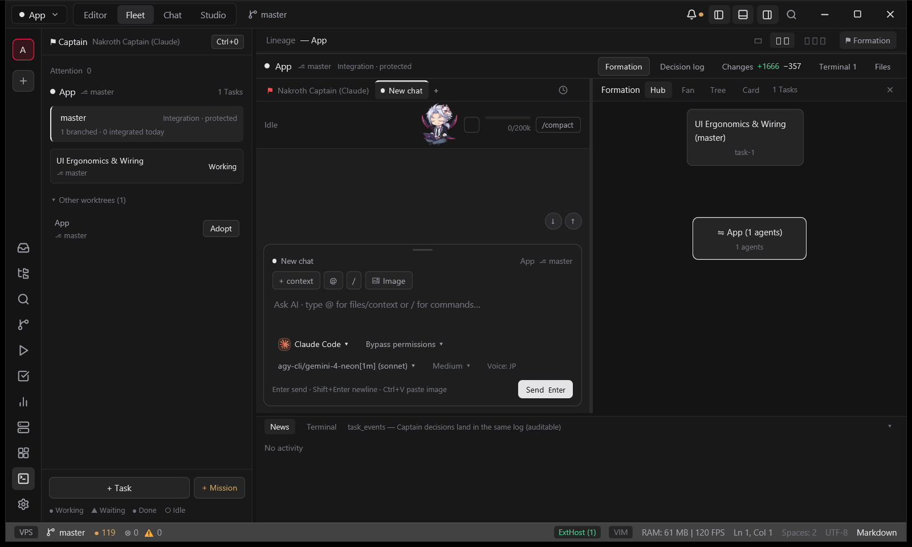

# Nakroth

**English** · [Bahasa Indonesia](#bahasa-indonesia) · [Download Latest (v1.1.2)](https://github.com/ShinRyu04/Nakroth/releases/latest) · [Website](https://nakroth-website.vercel.app) · [Issues](https://github.com/ShinRyu04/Nakroth/issues)

**Abyssal AI Command IDE & Multi-Agent Cockpit — built from scratch in Rust and GPUI.**

Nakroth is a native, GPU-rendered code editor and multi-agent workbench for Windows, Linux, and macOS. It talks directly to the AI coding CLIs you already use (**Claude Code**, **Oh My Pi (`omp`)**, **Google Antigravity (`agy`)**, **Codex**, **OpenCode**, **Gemini CLI**, **GitHub Copilot**) via persistent bidirectional workers — combining an editor, parallel Fleet orchestrator, fullscreen AI Chat, Visual Studio Designer, Pro VT100 ConPTY terminal, 10-screen OLED Mobile PWA + Custom VPS Relay, Remote VPS/SSH workflow, and 22 built-in native studios inside a single fast binary with zero Electron or Chromium overhead.

[](https://github.com/ShinRyu04/Nakroth/releases/latest)

-991B1B)
[](LICENSE)

---

## Why Nakroth?

Running multiple AI coding agents across projects, branches, and remote servers exposes the same friction everywhere:

- **Cold-boot latency on every turn.** Spawning fresh CLI processes per prompt wastes 10–20 seconds waiting for runtimes and MCP servers before a single token arrives.
- **Browser-engine bloat.** Electron editors consume 1–2 GB of RAM across a dozen processes before your first agent even starts thinking.
- **Fragmented workflows.** You bounce between an editor, a terminal, a diagram tool, a database browser, an API client, and an SSH session — losing thread context every time.

Nakroth puts all of it into one native GPUI surface:

1. **Silent Pre-Warmed Persistent Workers.** Bidirectional `stream-json`, `acp --stdio`, and `--mode rpc` sessions keep **Claude Code**, **Oh My Pi (`omp`)**, and **Antigravity (`agy`)** warm in the background with `MCP_CONNECTION_NONBLOCKING=1`, instant local slash commands (`/status`, `/doctor`, `/cost`, `/context`, `/learn`), Prompt Queue + `Run Now` steering, and interactive stdio `Allow / Deny` tool approvals.
2. **Four Purpose-Built Modes + Standalone Pages.** Switch cleanly between **Editor**, **Fleet**, **Chat**, and **Studio** — plus dedicated standalone **Extensions** and **Usage** views — without losing state or opening separate apps.
3. **10-Screen OLED Mobile PWA & Custom VPS Relay.** Pair your phone via real ISO QR code over LAN, Cloudflare HTTPS Tunnel, or your own VPS (`ssh -R` / custom HTTPS domain) with zero API key entry on mobile.
4. **Zero Electron.** Direct3D 11 on Windows, Vulkan on Linux, Metal on macOS — one native executable, ~61 MB active working set, 120 FPS rendering.

---

## Four Workspaces, One Binary

Code, orchestrate parallel agents, think in fullscreen chat, or architect UI and diagrams — pick the surface that fits the task in front of you.

<table>
<tr>
<td width="50%" valign="top">
<h3>Editor Mode</h3>
<p>120 FPS Tree-sitter editor (24+ languages), GPU minimap, LSP &amp; DAP stdio clients, inline Git hunk review, Pro VT100 ConPTY terminal with split PTY &amp; CLI quick-launch bar, Remote VPS/SSH auto-upload, and docked AI cockpit.</p>
<a href="docs/screenshots/editor.png"></a>
</td>
<td width="50%" valign="top">
<h3>Fleet Mode</h3>
<p>Run parallel coding agents across isolated Git worktrees with a Captain/Lead seat, live task tracking, Decision Log, Changes diff, integrated terminal, and interactive Hub / Fan / Tree / Card formation topology.</p>
<a href="docs/screenshots/fleet.png"></a>
</td>
</tr>
<tr>
<td width="50%" valign="top">
<h3>Chat Mode</h3>
<p>Distraction-free fullscreen AI workspace with synced past sessions (Claude, OMP, Codex, OpenCode), unified 2-pane Model Matrix, live streaming transcripts, SQLite cross-session Memory Bank, and open workspace file cards.</p>
<a href="docs/screenshots/chat.png"></a>
</td>
<td width="50%" valign="top">
<h3>Studio Mode</h3>
<p>Visual UI Designer (<code>.kdsgn</code>) with deterministic Rust GPUI / React Tailwind / Vue / HTML codegen, two-way Mermaid Flowchart editor, and Tarjan circular-dependency Import Graph.</p>
<a href="docs/screenshots/studio.png"></a>
</td>
</tr>
</table>

---

## Supported AI Agents & Providers

Bring the CLI subscriptions or local models you already pay for — no extra middleware required.

| Agent / Provider | Transport | Highlights |
| --- | --- | --- |
| **Claude Code** (`claude`) | Persistent bidirectional `stream-json` | Silent pre-warm, 0ms follow-up boot, `MCP_CONNECTION_NONBLOCKING=1`, thinking deltas, tool cards, stdio `Allow / Deny` |
| **Oh My Pi** (`omp`) | Persistent `--mode rpc` | Silent pre-warm, `--no-title` + ready handshake, live model & thinking switches, synced past sessions |
| **Google Antigravity** (`agy`) | Persistent `acp --stdio` / `stream-json` | Warm prompt cache across turns, `--effort` / `--model` / `--mode` control, full event streaming |
| **Codex CLI** (`codex`) | Structured `--json` stream | Reasoning steps, shell execution cards, session resume |
| **OpenCode** (`opencode`) | Structured JSON stream | Local profiles, SQLite busy retry, & model routing |
| **Gemini CLI** (`gemini`) | `stream-json` | Native model selection & streaming output |
| **GitHub Copilot · Hermes · Pi** | CLI connectors | Auto-discovered on `PATH` with cached binary resolution |
| **BYOK Direct API & Ollama** | Native HTTP / SSE + Tool Calling | Anthropic, OpenAI, Gemini, DeepSeek, local Ollama, and OpenAI-compatible gateways |

---

## Measured Footprint & Responsiveness

Measured on Windows 11 x64 (`v1.1.2` release build):

| Metric | Nakroth (`v1.1.2`) |
| --- | --- |
| **Baseline smoke RAM** (`--smoke-boot`) | `2.6 MB` |
| **Active IDE RAM** (Editor + Explorer + Pro Terminal + AI Panel) | `~61 MB` |
| **Frame pacing target** | `120 FPS` native GPU (Direct3D 11 / Vulkan / Metal) |
| **Windows installer size** (`Nakroth-Setup-1.1.2-x64.exe`) | `30.51 MB` (includes `nakroth-cli` & remote server) |
| **Local slash commands** (`/status`, `/doctor`, `/cost`, `/context`, `/learn`) | `< 10 ms` (0 tokens spent) |
| **Persistent follow-up latency** (Claude / OMP / `agy` Turn 2) | Instant warm session (skips ~15–20s cold boot) |

---

## Built-in Native Viewers & Power Studios

Everything runs lazily on demand (0 MB until opened) inside native GPUI tabs:

- **Data & Binary**: SQLite Studio (read/write SQL bar), CSV/Parquet Grid, Hex/PE/ELF/WASM Inspector, ZIP Archive preview, Markdown/FluxDoc, Jupyter `.ipynb`.
- **DevOps & API**: REST/GraphQL/cURL Studio (`.http`), OpenAPI Explorer + mock server, Docker Cockpit, Remote VPS/SSH Explorer with `Ctrl+S` auto-upload, Port/Tunnel Manager, `.env` Vault & secret-leak guard.
- **Security & Quality**: SAST Auditor + CVSS triage, Dependency/License Auditor, CyberChef/JWT/Regex Lab, Local SQLite FTS5 Hybrid RAG, Git Commit Graph & Shadow Checkpoints with 1-click Rewind.
- **Personalization & Updates**: Abyssal Crimson & Dark Steel theme + VS Code `.vsix`/JSONC theme importer, lazy-decoded companion mascot + soundboard, Trilingual UI (`EN` / `ID` / `JA`), Vim modal editing, in-app Release Ledger & signed SHA-256 auto-updater.

---

## Download & Install (`v1.1.2`)

### Quick Install (1-Line)

- **Windows (PowerShell):**
  ```powershell
  irm https://github.com/ShinRyu04/Nakroth/releases/latest/download/install.ps1 | iex
  ```
- **Linux / macOS:**
  ```bash
  curl -fsSL https://github.com/ShinRyu04/Nakroth/releases/latest/download/install.sh | sh
  ```

### Direct Packages

Grab the latest installers from **[Releases](https://github.com/ShinRyu04/Nakroth/releases/latest)**:

| Platform | Package | Size | Install / Run |
| --- | --- | --- | --- |
| **Windows 10/11 (x64)** | `Nakroth-Setup-1.1.2-x64.exe` | `30.51 MB` | Double-click installer (per-user or all-users, adds `nakroth` / `nk` CLI & Explorer menu) |
| **Windows Portable (x64)** | `Nakroth-Windows-x64-Portable.zip` | `42.82 MB` | Extract anywhere and run `nakroth.exe` |
| **Linux — Ubuntu / Debian** | `nakroth_1.1.2_amd64.deb` | `37.48 MB` | `sudo apt install ./nakroth_1.1.2_amd64.deb` |
| **Linux — Fedora / openSUSE / RHEL** | `nakroth-1.1.2-1.x86_64.rpm` | `46.72 MB` | `sudo dnf install ./nakroth-1.1.2-1.x86_64.rpm` |
| **Linux — Universal** | `Nakroth-1.1.2-x86_64.AppImage` | `46.43 MB` | `chmod +x Nakroth-*.AppImage && ./Nakroth-*.AppImage` |
| **macOS (Apple Silicon M1–M4)** | `Nakroth-1.1.2-arm64.dmg` / `.pkg` | `45.92 / 44.31 MB` | Drag to Applications (or run `.pkg`); first launch on ad-hoc builds: `xattr -cr /Applications/Nakroth.app` |

Verify integrity using `SHA256SUMS.txt` attached to every release.

---

## Coming Next (`v1.1.3` — In Active Testing)

- **Original Multi-Agent Session Lanes**: true per-session isolated CLI workers (`1–4 Split` lanes, zero chat mixing, live **File-Collision Radar**, and 1-click **Context Hand-off**) alongside Fleet Classic.
- **Creative Studio Pro**: Pure-Rust GPUI **Vector Art** (8-pt resize, Pen Bezier, Boolean ops, SVG), **Multi-Layer Raster** (layer masks, Flip/Rotate, Text, PNG), **3D Viewport & UV Paint** (3D Gizmo, Subdivide/Extrude, `.obj`/`.gltf`/Blender bridge), and **Procedural Material Nodes** (live 2D/3D PBR preview, `.wgsl`/`.glsl`).
- **VS Code-Grade Terminal & Scroll Precision**: character-level drag selection, multi-tab shell sidebar, interactive scrollbar, SGR 1006 TUI mouse forwarding, and viewport-exact scroll clamping across Editor & all panels.

---

## Bahasa Indonesia

**Nakroth** adalah IDE AI-first dan cockpit multi-agent yang dibangun murni dengan **Rust + GPUI** (tanpa Electron/Chromium) untuk Windows, Linux, dan macOS.

- **4 Mode Terpadu + Halaman Mandiri**: **Editor** (Tree-sitter 24+ bahasa, LSP/DAP, Pro VT100 ConPTY terminal + split PTY, Remote VPS/SSH auto-upload `Ctrl+S`), **Fleet** (orkestrasi paralel lintas git worktree), **Chat** (ruang AI fullscreen + Model Matrix 2-pane + Memory Bank SQLite), **Studio** (UI Designer codegen Rust GPUI/React/Vue/HTML, Diagram Mermaid 2-arah, Import Graph), ditambah halaman mandiri **Extensions** & **Usage**.
- **Mobile PWA 10-Layar & Custom VPS Relay**: kontrol agen dari HP via QR code (LAN, Cloudflare Tunnel, atau VPS SSH `-R` / domain HTTPS sendiri) tanpa perlu ketik API key di HP.
- **Cepat & Ringan**: silent pre-warm worker untuk **Claude Code**, **Oh My Pi (`omp`)**, dan **Antigravity (`agy`)**, slash command lokal instan (`< 10 ms`), serta RAM aktif ~61 MB dengan rendering GPU 120 FPS.
- **22 Power Studios Bawaan**: SQLite Studio, Hex/Binary Inspector, HTTP/GraphQL Studio, Docker Cockpit, `.env` Vault, SAST Auditor, CyberChef/JWT Lab, Auto-Updater terverifikasi SHA-256, dan UI 3 bahasa (`ID` / `EN` / `JA`).
- **Unduh**: Ambil installer terbaru **`v1.1.2`** di halaman [Releases](https://github.com/ShinRyu04/Nakroth/releases/latest) atau via 1-line installer di atas.

---

## License

Copyright © 2026 [ShinRyu04](https://github.com/ShinRyu04). **All Rights Reserved.**  
Official prebuilt binaries are provided for personal and evaluation use. See [LICENSE](LICENSE) for details.
